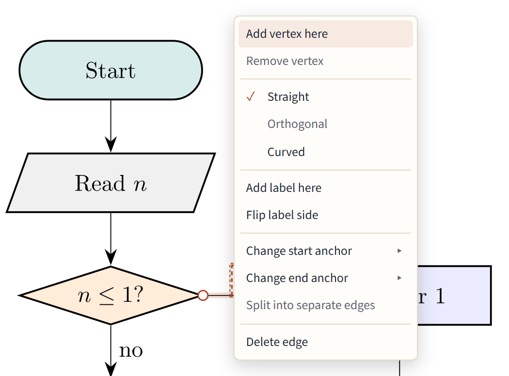

# Edges and labels

## Drawing an edge

Point at a node: four handles appear on its sides. Drag from one of them and drop on another node. Dropped on the middle of a node, the edge meets its border, pointing at the other end; dropped on one of the target's handles, it attaches to that anchor (`(base.south)`). The new edge is written as its own `\draw`.

Click an edge to select it. Its code is highlighted, and the properties panel shows its form, labels, arrows and line.

## Reconnecting an edge

Drag either end of a selected edge onto another node, or onto one of its anchors. When the edge's statement comes before the new node in the code, the editor moves the `\draw` below that node if that is safe, and says why when it isn't.

## The edge menu

Right-click an edge (or select it and press the <kbd>Menu</kbd> key, or <kbd>Shift</kbd>+<kbd>F10</kbd>). The menu always lists the same items in the same order. Those that don't apply to this edge are grayed out; point at one to see why.

- **Add vertex here** and **Remove vertex**: a corner where you clicked, or take one away.
- **Straight**, **Orthogonal** and **Curved**: the edge's form; the current one is ticked.
- **Add label here** and **Flip label side**.
- **Change start anchor** and **Change end anchor**: pick a side or corner of the node, or the border pointing at the other end.
- **Split into separate edges**: one `\draw` per edge.
- **Delete edge**.

## Corners, orthogonal edges and curves

- **Corners:** a selected straight edge shows small handles in the middle of each segment. Drag one to add a corner there. Drag a corner to move it, and double-click it to remove it.
- **Orthogonal** edges run in horizontal and vertical pieces, written with TikZ's `|-` and `-|`. Drag a segment to slide it sideways; the code follows.
- **Curved** edges start as `bend left`. Drag the middle handle to bend more or less, or a handle near an end to change only how that end leaves (`out=` and `in=`).
- **Loops** (as in the State machine template) take their side from their key, such as `loop above`; change it in the code. Labels, properties and Delete work on loops as on any edge.

## Labels

- **Add label here** writes a label where you clicked the edge, and lets you type it.
- Drag a label along its edge to move it; the code gets `pos=`.
- Double-click a label to edit it.
- **Flip label side** puts it on the other side of the line.
- An edge leaving a decision gets "Yes" or "No" when you add it, following the words your picture already uses.

If a line ends up running through its own label after you move a node, the label gets a small marker with a one-click fix.

## Arrows, dashes, color and width

With an edge selected, the properties panel sets the arrow direction and tip (Stealth, Latex, To, Triangle), Solid, Dashed or Dotted lines, the color and the width. Like nodes, each change applies to **This edge** or to every edge of its style.

Arrow tips belong to a whole `\draw`. When one `\draw` holds several edges, the panel offers **Split and apply**: it splits the path into one statement per edge and sets the tip on yours only.

## Shared ends

When two edges of one `\draw` share an end (`(a) -- (b) -- (c)`), that end can't be dragged on its own. **Split into separate edges** in the edge menu makes them separate statements; arrow tips stay where they were.
