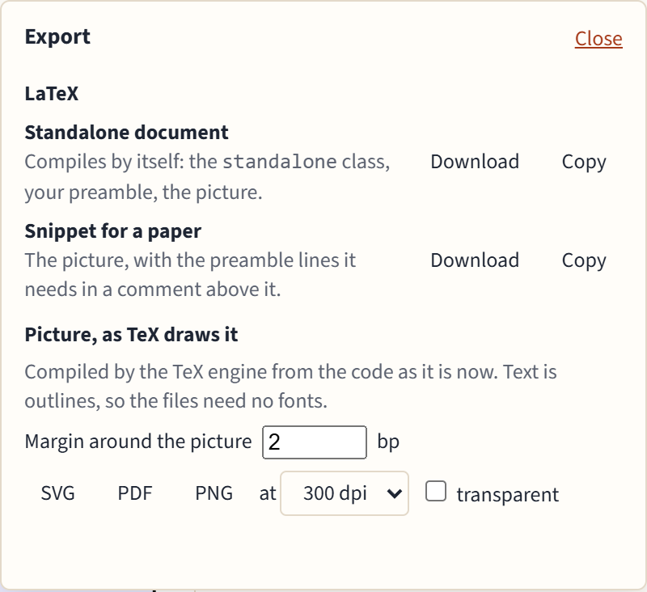

# Exporting and sharing

## Export

**Export** in the toolbar saves the picture on screen.

### LaTeX

- **Standalone document:** compiles by itself, with the `standalone` class, your preamble and the picture.
- **Snippet for a paper:** the `tikzpicture` alone, with the preamble lines it needs (`\usetikzlibrary`, `\tikzset`, colors) in a comment above it, ready to paste into your paper.

Each can be downloaded or copied. These are your own code, so they keep your packages and fonts.

### Pictures, as TeX draws them

**SVG**, **PDF** and **PNG** are compiled by the TeX engine from the code as it is now, so they look exactly like the TeX preview. Text is turned into outlines, so the files need no fonts. Set the margin around the picture, and for PNG the resolution (72 to 600 dpi) and whether the background is transparent.

If TeX reports errors, the export says so and contains what TeX drew anyway.

The **View** setting (grayscale, color blindness) never affects exports: they always have the picture's own colors.

## Share links

**Share** makes a link that carries your code itself, compressed, in the part of the address after the `#`. Browsers never send that part to a server, so nothing is uploaded or stored anywhere. Opening the link opens the diagram in a new tab.

- Anyone with the link can read the code.
- Your pasted preamble and page settings aren't included.
- Long diagrams make long links. Above 8,000 characters the panel warns you: some chat and mail programs cut long links, so send the file instead if the picture doesn't open.
