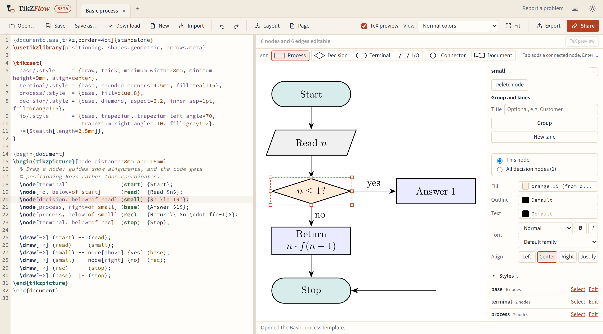
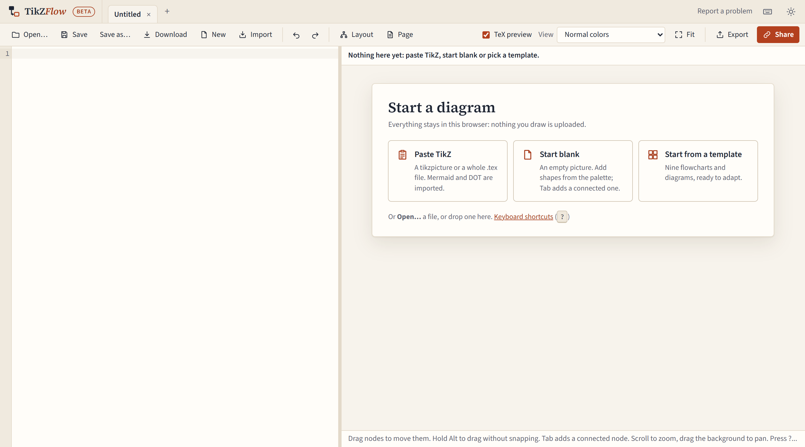

# Getting started

## The editor at a glance

- **The app bar** at the top holds the tabs (one per diagram), Report a problem, the keyboard shortcuts button and the theme switch (same as system, light or dark).
- **The toolbar** below it: Open…, Save, Download, New and Import; Undo and Redo; Layout and Page; then TeX preview, View and Fit; and Export and Share on the right.
- **The code pane** on the left holds your TikZ code. It is a full editor: type in it whenever you like.
- **The canvas** on the right draws the picture. The palette of shapes runs along its top.
- **The properties panel** on the right edits the selected node or edge.
- **The summary** under the canvas says what the editor understood, for example "6 nodes and 6 edges editable".

Click a node and its code is highlighted; put the cursor in a node's code and the node is selected.

## Your first diagram

When the editor has nothing open, it offers three ways to start:

- **Paste TikZ** takes a `tikzpicture`, or a whole `.tex` file, from the clipboard. A Mermaid or Graphviz DOT diagram is imported as TikZ instead. Pressing <kbd>Ctrl</kbd>+<kbd>V</kbd> anywhere on this screen does the same.
- **Start blank** opens an empty picture.
- **Start from a template** shows twelve ready-made diagrams to adapt.

Then build it up:

1. Click a shape in the palette (Process, Decision, Terminal, I/O, Connector or Document). It is added after the selected node, connected to it, or in the middle of the view. You can also drag a shape onto the canvas.
2. Type to change the new node's label, or double-click any node to edit its label.
3. Press <kbd>Tab</kbd> to add the next step, connected after the selected node, and <kbd>Enter</kbd> to add one beside it.
4. Drag nodes to arrange them. Guides show when a node lines up with another, and the code gets positioning keys such as `below=of start` rather than coordinates.
5. Draw an edge by dragging from one of the four handles that appear on a node's sides when you point at it, and dropping on another node.

The code stays readable as you go: new shapes get a named style in `\tikzset`, nodes get names from their labels, and the `\usetikzlibrary` line gains and loses libraries as needed.

## The two previews

The canvas first draws the picture itself, instantly. A moment later a real TeX engine, running in your browser, compiles it and the canvas shows TeX's own picture. See [The TeX preview](tex-preview.md).

## Where your work goes

Everything you type is kept in this browser as you go, in its own tab. It is not uploaded anywhere, and that also means it isn't backed up anywhere: save important diagrams as files. See [Saving, tabs and your work](saving.md).
