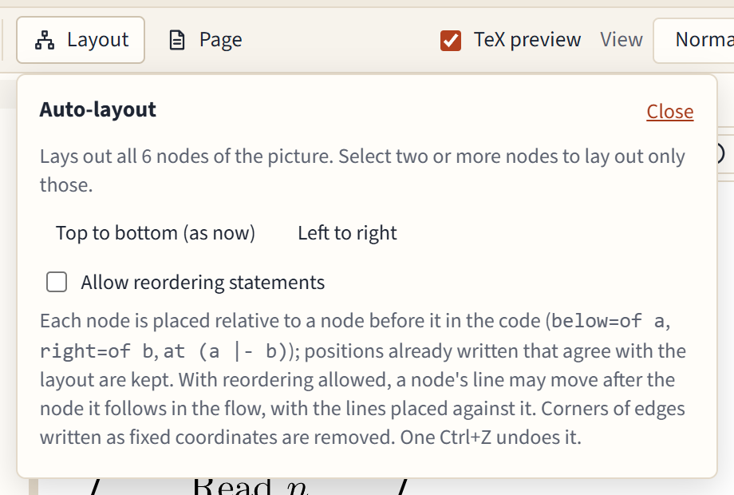

# Layout, groups and swimlanes

## Automatic layout

**Layout** in the toolbar arranges the picture for you, **Top to bottom** or **Left to right**. The current direction is marked "(as now)".



- It lays out the whole picture, or only the selected nodes when you have selected two or more.
- The result is written the way you would write it: each node relative to one before it (`below=of read`, `right=of check`), with distances only where they are needed. A relation that already says what the layout wants is kept as you wrote it.
- Corners of edges written as fixed coordinates are removed, since the nodes they went around have moved. Edges keep their form otherwise.
- Locked nodes stay where they are; the panel names them.
- One <kbd>Ctrl</kbd>+<kbd>Z</kbd> undoes the whole layout.

A large picture can take a moment: a badge over the canvas shows the progress, and **Cancel** stops it. The page stays responsive meanwhile.

### Allow reordering statements

TikZ can only place a node relative to a node defined before it. With **Allow reordering statements** ticked, the layout may move a node's line further down the code when that gives a cleaner relation, and only when moving it is safe. It is off by default, because it changes the order of your code.

### Groups and lanes

Each lane's nodes stay in their lane. A group's nodes are kept together when the boxes would otherwise cross, or a box would cover another group's node.

## Groups

Select some nodes, type a title in **Group and lanes** in the properties panel if you like, and press **Group**. The editor draws a box around them, behind everything else:

```latex
\node[group, fit=(check) (base), label={[group title]north:Checks}] (checks) {};
```

It uses the `fit` and `backgrounds` libraries and adds them for you. The box follows its nodes when they move; dragging the box moves them all. Click an empty part of a box to give it a title or change it.

## Swimlanes

Lanes are boxes that share a top and a bottom (or a left and right side), one per role or phase.

1. Select the nodes of the first lane, type its title, and press **New lane**.
2. Select the next lane's nodes and press **New lane** again.

In a picture that runs down, lanes stand side by side; in one that runs across, they lie one above the other, with their titles turned along the side.

- Drag a node into another lane to move it there; the lanes stretch to stay even.
- **Move to lane** moves the selected nodes into the lane you pick.
- **Take out of** removes the selected nodes from their groups and lanes.
- Deleting a node keeps the lanes valid and even.

The Swimlane process and PRISMA 2020 templates show lanes at work.
