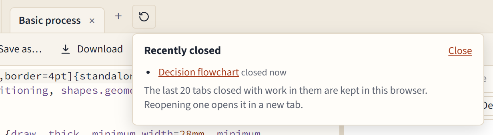
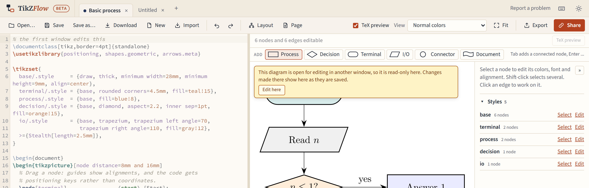

# Saving, tabs and your work

## Your work lives in this browser

TikZFlow has no server and no accounts. As you type or drag, your diagram is saved **in this browser's storage on this computer**, and nowhere else. That is what keeps your diagrams private, and it has consequences worth knowing:

- **Clearing this site's data** (or all browsing data, cookies and site data) in your browser's settings **deletes your diagrams**, Recently closed included.
- **Another browser, another computer, or another browser profile** starts empty: it can't see what you drew here.
- **A private or incognito window** forgets everything when it closes, and some refuse storage altogether; then your work lives only in the open page.
- Browsers can also clear the storage of sites you haven't visited in a long time, or when the disk is nearly full.

> **Save important diagrams as files.** The browser's copy is a convenience, not a backup. A `.tex` file on your disk (or in your usual cloud folder) is yours to keep, back up and put under version control.

## Saving files

- **Save** (<kbd>Ctrl</kbd>+<kbd>S</kbd>) writes to the file the tab came from. In Chromium browsers (Chrome, Edge, Opera), a file you opened with **Open…** is saved in place. Elsewhere, and for a diagram that has no file yet, Save downloads a `.tex` file.
- **Save as…** (Chromium browsers) saves to a new file, which the tab then saves to.
- **Download** always downloads the code as a `.tex` file.

A **●** after the tab's name means the code has changed since the file was opened or saved. The browser's copy is always current either way.

## Tabs

Each diagram has its own tab in the bar at the top, with its own code, undo history, file and TeX picture. <kbd>Ctrl</kbd>+<kbd>Z</kbd> undoes only the tab on screen. Your tabs come back when you reload or come back later, on the one you were on.

- **+** opens a new, empty tab.
- **Open…**, dropping a file, **Import**, **New**, a template from the home page, and a share link each open a new tab, so the diagram on screen is never replaced. When the tab on screen is empty, it is used instead.
- Click a tab to show it; with a tab focused, <kbd>←</kbd> and <kbd>→</kbd> move between tabs.
- Close a tab with its **×** or a middle click. There is no question to answer, because nothing is lost: it goes to Recently closed.

## Recently closed

The clock button after the tabs (it appears once you have closed a tab with work in it) opens **Recently closed**: the tabs you closed, newest first, with when you closed them. Click one to open it again, in a new tab, together with its file if it had one.

- The last **20** tabs closed with work in them are kept, in this browser like everything else (so clearing site data clears them too).
- A tab that was empty, or held a template you hadn't changed, isn't kept: there was nothing to lose.
- Undo history isn't kept; reopened tabs start a fresh history.

## Two windows

You can have TikZFlow open in two browser windows or browser tabs. They show the same set of tabs, but **only one window at a time can edit a given diagram**, so the two can never overwrite each other's work:

- A new window starts on a diagram the other window isn't showing (or an empty tab).
- When you show a diagram that is being edited in another window, it is **read-only**. A banner says so, and the diagram follows the other window's changes as they are saved. A small dot on a tab means another window has it open.
- **Edit here** in the banner moves editing to this window; the other window turns read-only. When the editing window closes or switches to another diagram, a read-only window showing it takes over by itself.

In the unlikely case that two windows did save different versions of a diagram (an old browser without the locking this relies on, say), neither is lost: the second is kept as a new tab called "… (your copy)".

## If the browser closes suddenly

Your changes are saved half a second after you make them, and again when you switch tabs or close the page. If the page closes before that save finishes, the editor finds what was missing the next time it starts and puts it back; if that diagram was changed in another window meanwhile, the rescued version opens as "… (recovered)" next to it.

The one thing that can be lost is the last half second of work before the browser crashes or the computer loses power.
