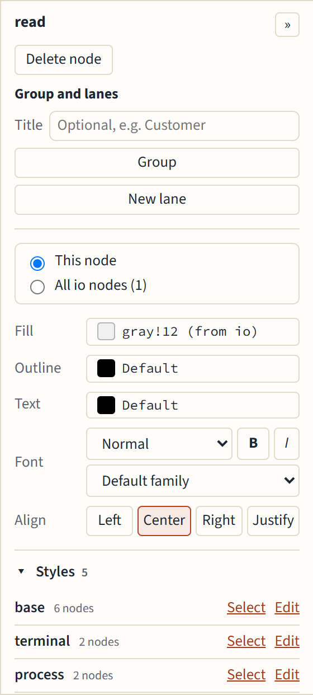

# Colors, fonts and styles

## The properties panel

Select a node and the panel on the right edits it:

- **Fill**, **Outline** and **Text** colors.
- **Font:** size (Tiny to Huge), **B**old, *I*talic, and the family: serif (`\rmfamily`), sans (`\sffamily`) or mono (`\ttfamily`).
- **Align:** Left, Center, Right or Justify. Justify needs a text width, so the editor sets one from the text's current width.
- **Delete node**.

The « and » button hides and shows the panel; the editor remembers your choice. Select several nodes with Shift-click to change them all at once.

## This node, or all nodes of its style

Most nodes get their look from a named style, such as `process` in `\tikzset`. The panel asks where a change goes:

- **This node** writes the option on the node itself.
- **All process nodes** edits the style, so every node that uses it changes, and the code stays tidy.

When a style isn't written in a form the editor can change safely, the second choice is grayed out and says why.

**Detach from process** (one button per style the node names) copies the style's options into the node's own, so later edits of the style don't change it. The node looks exactly as before; the style's own styles are copied too, and an option the node already sets after the style is left out. A style written as code (`/.code`) or with two arguments can't be copied, and the status bar says so.

## Colors

The color picker offers, in order: the colors your document already defines (`\definecolor`), common xcolor mixes such as `blue!20`, the basic colors, and a custom color. Give a custom color a name and **Add named color** adds a `\definecolor` and uses it; **Use without a name** writes its RGB values instead.

## The Styles list

Under the panel, **Styles** lists your picture's styles and how many nodes use each. **Edit** changes a style's options for every node using it, and **Select** selects those nodes.

When several nodes spell out the same options, the list shows them under **Repeated options**, and **Factor out** turns them into a named style that those nodes then use.

## Libraries

You don't need to manage `\usetikzlibrary` yourself: when an edit needs a library (`positioning`, `shapes.geometric`, `fit`, `arrows.meta`…), it is added, and one nothing uses any more is removed.

## Names that clash with TikZ

A style named like a TikZ key, such as `step`, makes TeX fail on every node that uses it. The summary warns about it ("Style step is a TikZ key"), and Details shows the definition.
